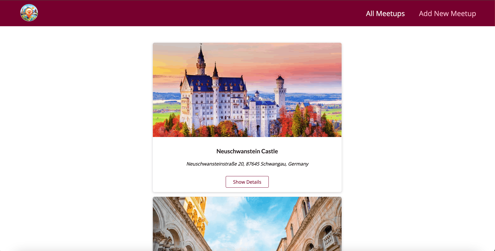
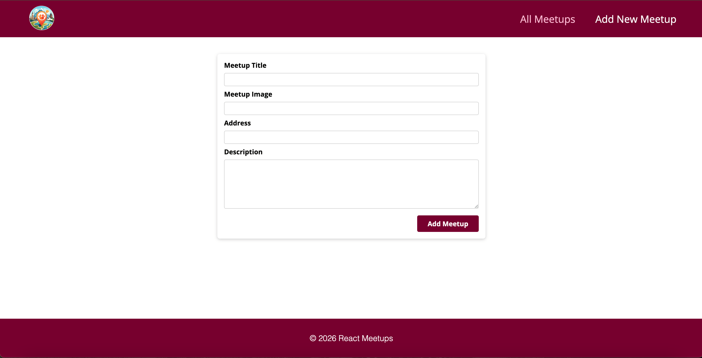
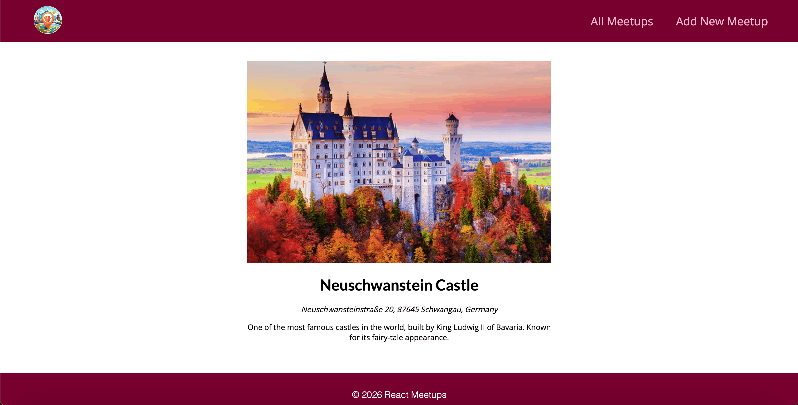

# React Meetups

Небольшое full-stack веб-приложение для просмотра и добавления React-встреч. Проект демонстрирует работу с маршрутизацией Next.js, статической генерацией страниц, API routes, MongoDB и формами на React.

## Возможности

- просмотр списка всех встреч;
- переход на отдельную страницу с подробностями встречи;
- добавление новой встречи через форму;
- клиентская валидация названия, URL изображения, адреса и описания;
- защита от повторной отправки формы;
- уведомления об успешной операции и ошибках;
- обработка недоступной базы данных и отсутствующей встречи;
- адаптивная компоновка, общая навигация и переиспользуемые UI-компоненты.

## Технологии

- **Next.js 16** (Pages Router)
- **React 18**
- **TypeScript** в строгом режиме
- **MongoDB** и официальный драйвер `mongodb`
- **CSS Modules** и глобальные CSS-стили
- **react-hot-toast** для уведомлений

## Архитектура и технические решения

- Главная страница получает список встреч на сервере через `getStaticProps` и обновляется по ISR раз в секунду.
- Страница `/[meetupId]` создаётся статически для известных записей. `fallback: 'blocking'` позволяет сформировать страницу для новых идентификаторов по запросу; повторная проверка данных выполняется раз в 10 секунд.
- `pages/api/new-meetup.js` принимает `POST`-запрос и сохраняет полученные данные в коллекцию `meetups` MongoDB.
- Валидация вынесена из компонента формы в `lib/validation/meetupValidation.ts`, поэтому правила не смешиваются с UI.
- Общие элементы интерфейса (`Layout`, навигация, footer и `Card`) отделены от компонентов предметной области встреч.
- Для каждой страницы заданы отдельные SEO-метаданные через `next/head`.

## Что реализовано самостоятельно

- страницы списка, добавления и деталей встречи, включая динамический маршрут;
- интеграция MongoDB для чтения и добавления данных;
- API endpoint для создания встречи;
- клиентская валидация формы и вывод сообщений об ошибках;
- состояние отправки формы и защита от двойного submit;
- toast-уведомления, обработка ошибок загрузки и сценария «встреча не найдена»;
- структура компонентов, CSS Modules, адаптивные стили и активное состояние навигации.

## Структура проекта

```text
components/
  layout/                 # общий Layout, навигация и footer
  meetups/                # список, карточка, детали и форма встречи
  ui/                     # переиспользуемые UI-компоненты
lib/validation/           # правила валидации данных формы
pages/
  api/new-meetup.js       # POST API для создания встречи
  [meetupId]/index.tsx    # динамическая страница деталей
  new-meetup/index.tsx    # страница добавления встречи
  index.tsx               # список встреч
  _app.tsx                # глобальный Layout и Toaster
  _document.tsx           # HTML-документ и favicon
public/                   # статические файлы
styles/                   # глобальные стили
```

## Установка и запуск

### Требования

- Node.js 20.9 или новее
- npm
- доступная MongoDB база с коллекцией `meetups`

### Шаги

```bash
git clone <repository-url>
cd react-meetups
npm install
npm run dev
```

После запуска откройте [http://localhost:3000](http://localhost:3000).

> Сейчас строка подключения к MongoDB находится непосредственно в серверных файлах страниц и API route. Для безопасного публичного развёртывания её следует перенести в переменную окружения и заменить текущие учётные данные.

## Доступные npm scripts

| Команда | Назначение |
| --- | --- |
| `npm run dev` | запуск локального сервера разработки Next.js |
| `npm run build` | создание оптимизированной production-сборки |
| `npm run start` | запуск production-сервера после `npm run build` |

В проекте пока не настроены отдельные scripts для линтинга и тестов.

## Скриншоты

Скриншоты пока не добавлены. Для портфолио можно сохранить их в `public/screenshots/` и подключить сюда:

```md



```

## Примечание о production-сборке

Статическая генерация страниц обращается к MongoDB во время `npm run build`. Поэтому для успешной production-сборки базе данных должно быть доступно сетевое подключение. В текущем окружении TypeScript-проверка и компиляция завершились успешно, но сборка остановилась при обращении к MongoDB из-за ошибки соединения.
